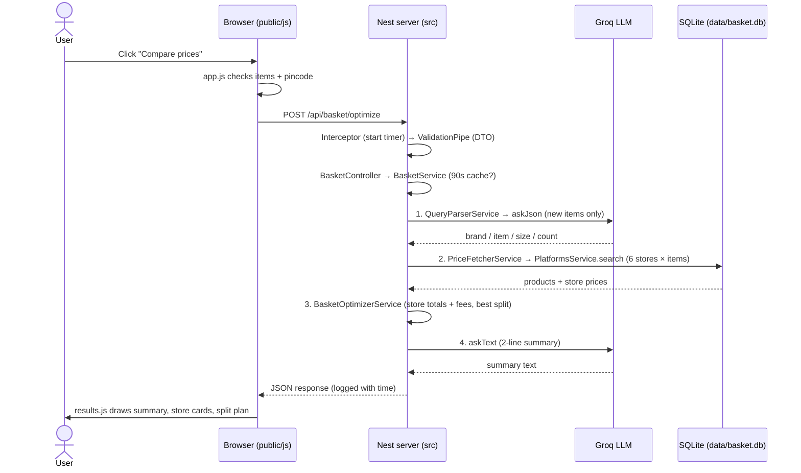
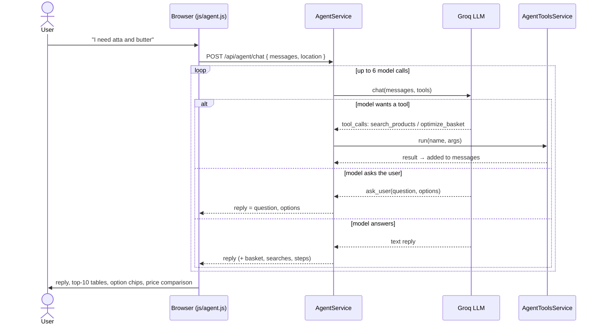

# Developer Guide

How the app works, one flow per section. For what every folder and file contains, see [PROJECT_STRUCTURE.md](PROJECT_STRUCTURE.md).

## Contents

- [Search flow](#search-flow): from "Compare prices" to results
- [Agent flow](#agent-flow): the AI shopping assistant chat (tool-calling loop)

---

## Search flow

What happens, file by file, when a user searches their basket.

### The whole flow at a glance



```
Browser                         Server                                       Data
───────                         ──────                                       ────
app.js ──► api.js ──POST──► RequestLoggingInterceptor
                            ValidationPipe + OptimizeBasketDto
                            BasketController.optimizeBasket()
                            BasketService.optimizeBasketCached()
                              │ cache hit? → return
                              └► BasketService.optimizeBasket()
                                   1. QueryParserService.parseBasket() ──► LlmService.askJson() ──► Groq
                                        └ normalizer.parseQuery() (rules)
                                   2. PriceFetcherService.fetchPrices() ─► PlatformsService.search() ─► SQLite
                                   3. BasketOptimizerService
                                        ├ calculatePlatformSummaries()
                                        └ calculateSplitCart()
                                   4. BasketService.summarize() ────────► LlmService.askText() ───► Groq
results.js ◄──JSON──────────────────┘
```

---

### Part A: In the browser

#### A1. User clicks "Compare prices" — `public/js/app.js`

The click handler:

1. Reads the list: `basket.getItems()` (from `public/js/basket.js`), e.g. `["amul butter 500g", "doodh 1L", "12 eggs"]`.
2. Reads the location: `getLocation()` (from `public/js/location.js`) → `{ latitude, longitude, pincode, address }`. The pincode was filled in from the map (Nominatim reverse lookup) or typed by the user.
3. Checks before calling the server:
   - basket not empty → otherwise shows "Add at least one item first."
   - pincode is 6 digits → otherwise shows "Enter a valid 6-digit pincode."
4. Disables the button ("Comparing…") and calls `renderLoading()` (`public/js/results.js`) to show the spinner.
5. Calls `optimizeBasket(items, location)`.

#### A2. The API call — `public/js/api.js`

```http
POST /api/basket/optimize
Content-Type: application/json

{
  "items": ["amul butter 500g", "doodh 1L", "12 eggs"],
  "location": { "latitude": 18.508885, "longitude": 73.956373, "pincode": "412307", "address": "Gopalpatti, Pune" }
}
```

- Gives up after **90 seconds** (`AbortSignal.timeout`) with "The stores took longer than 90 seconds…".
- If the server can't be reached: "Could not reach the server. Is it running?"
- If the server answers with an error, it shows Nest's `message` (e.g. the validation reason).

---

### Part B: On the server

#### B1. Request timer — `src/common/interceptors/request-logging.interceptor.ts`

Registered for every route in `src/main.ts`. Notes the start time; when the response leaves it logs:

```
# info # HTTP # POST /api/basket/optimize 200 706ms
```

or, on failure, the status and reason (`400 ... location.pincode must be a valid 6-digit pincode`).

#### B2. Body validation — `ValidationPipe` + `src/modules/basket/dto/optimize-basket.dto.ts`

Turned on in `src/main.ts`. The body must match `OptimizeBasketDto`:

| Field | Rule |
|---|---|
| `items` | array of 1–30 non-empty strings, each ≤ 100 characters |
| `location` | required |
| `location.latitude` / `longitude` | numbers in valid range |
| `location.pincode` | 6 digits, not starting with 0 |
| anything else | rejected (`forbidNonWhitelisted`) |

If it fails, Nest returns **400** immediately with the reasons, and nothing below runs.

#### B3. Controller (API entry point) — `src/modules/basket/basket.controller.ts`

`@Controller('basket')` + `@Post('optimize')`, under the global `/api` prefix from `main.ts` (`app.setGlobalPrefix('api')`) → **`POST /api/basket/optimize`**. `optimize(@Body() dto: OptimizeBasketDto)` calls `basketService.optimizeBasketCached(dto.items, dto.location)`. Returns **200**.

#### B4. Cache check — `src/modules/basket/basket.service.ts` → `optimizeBasketCached()`

Cache key = the items (lower-cased, sorted) + latitude/longitude rounded to 3 decimals.

- **Same basket within 90 seconds** → returns the saved result. Log: `Cache hit: 3 items, result is 12s old`
- **Identical request already running** → waits for it and shares its result. Log: `Same basket already running, sharing its result`
- **Otherwise** → runs `optimizeBasket()` (below), then saves the result.

#### B5. The pipeline — `src/modules/basket/basket.service.ts` → `optimizeBasket()`

Logs `Start: 3 items [...], pincode 412307`, then runs four steps. Each step logs what it produced and how long it took.

---

##### Step 1/4 — Understand the list: `src/modules/basket/query-parser.service.ts` → `parseBasket()`

Goal: turn free text into a structured item (`ParsedItemQuery` in `src/common/types/commerce.types.ts`).

1. **Rules always run** — `src/common/utils/normalizer.ts` → `parseQuery()`:
   - **brand**: matches a brand name from the catalog (`src/modules/database/seed/catalog-spec.ts`), as a whole word ("amul butter" → Amul).
   - **size**: "500g" → 500, "5kg" → 5000, "1L" → 1000 (`extractWeightInGrams`).
   - **count**: "12 eggs", "6 pcs", "pack of 4" → 12 / 6 / 4 (`extractPieceCount`).
   - **item name**: the text with brand and size removed (`cleanCategory`).
2. **LLM improves it** (only for items not seen before; results are cached per item):
   - One call for the whole list → `src/modules/llm/llm.service.ts` → `askJson()` → Groq (`qwen/qwen3.8-27b`, JSON mode, 15s timeout).
   - Returns `brand`, `genericCategory` (English, handles Hinglish: doodh → Milk, dahi → Curd), `weightGrams`, `count`.
   - If the LLM is off (no `GROQ_API_KEY`) or fails, the rules result is used.
3. **Merge**: LLM values win, rules fill the gaps.

Example result:

| Typed | brand | category | size / count |
|---|---|---|---|
| `amul butter 500g` | Amul | Butter | 500 g |
| `doodh 1L` | – | Milk | 1000 ml |
| `12 eggs` | – | Eggs | 12 pcs |

Logs:
```
# info # QueryParserService # Asking LLM about 3 new item(s); 0 already cached
# info # LlmService # askJson → qwen/qwen3.8-27b: 538ms, 359 tokens
# info # BasketService # 1/4 QueryParserService.parseBasket: "amul butter 500g" → Amul Butter, ... (545ms)
```

---

##### Step 2/4 — Find prices: `src/modules/basket/price-fetcher.service.ts` → `fetchPrices()`

Runs once per item. For each of the 6 stores (`PlatformsService.platforms`, read from the `platforms` table):

1. **`src/modules/platforms/platforms.service.ts` → `search(platform, query)`** runs SQL on `listings JOIN products` (`data/basket.db`):
   - **First try — exact product type/keyword**: `products.keywords LIKE '%|butter|%'`. Keywords include Hinglish, so "doodh" finds milk.
   - **Fallback — every word**: `products.search_text LIKE '%toned%' AND ... LIKE '%milk%'`. Size words and numbers are ignored.
   - Rows of the requested brand come first, then cheapest. Max 50 per store.
   - Each row becomes a `ProductItem` (`toProductItem`): title with size ("Amul Salted Butter, 500 g"), price, MRP, discount, in stock, rating, review count, and `fingerprint` = the same product id on every store.
2. Back in `fetchPrices()`: products are sorted again — **requested brand first, then cheapest**.

Result: a list of `PlatformSearchResult` (one per item per store) with `status` FOUND / OUT_OF_STOCK / NOT_FOUND.

Log:
```
# info # BasketService # 2/4 PriceFetcherService.fetchPrices: 3 items × 6 stores, found at 18 of 18 (11ms)
```

> Today this reads the **sample** database. A real price source (partner or data-provider API) would replace `PlatformsService.search()` and nothing else would change.

---

##### Step 3/4 — Find the cheapest way to buy: `src/modules/basket/basket-optimizer.service.ts`

**a) `calculatePlatformSummaries()` — best total per store**

For each store and each item, `candidatesFor()`:
1. Keeps only **in-stock** products.
2. Works out **how many packs** are needed — `packsNeeded()`: asked 1 kg, pack is 500 g → 2 packs; asked 12 eggs, pack of 6 → 2.
3. Marks **other brand** (`isSubstituted`) when the user asked for a brand and this isn't it.
4. Sorts: **requested brand first, then lowest cost** (price × packs). The first one is that store's pick; the rest become the dropdown alternatives.

Then for the store: subtotal = sum of picks, plus **`fees()`**:

| Fee | When |
|---|---|
| delivery | subtotal below the store's free-delivery threshold |
| handling | every order |
| platform | every order |
| small cart | subtotal below the store's small-cart threshold |

`totalCost = subtotal + fees.total`. Stores are ranked: **has every item → found more items → cheapest**.
The **best single store** = the first store that found at least one item (`BasketService`).

**b) `calculateSplitCart()` — best split across stores**

1. Tries **every combination of stores** (6 stores → 63 combinations).
2. In each combination, every item goes to its best option among those stores.
3. Adds **each used store's fees** on its own subtotal.
4. Keeps the cheapest total; on a tie, the one with fewer orders.
5. **Savings** are only shown against a store that has every item.

Log:
```
# info # BasketService # 3/4 BasketOptimizerService: best JioMart Quick ₹347 (3/3 items), split ₹347 across 1 store(s) (0ms)
```

---

##### Step 4/4 — AI summary: `basket.service.ts` → `summarize()` → `llm.service.ts` → `askText()`

Skipped when no store found anything. Otherwise sends the basket, the best store, its total, **which items are missing there**, and the split saving, and asks for 2 short sentences using only those facts. Cached per basket + store + total. Added to the response as `[AI Insights]: ...` in `agentLogs`.

Logs:
```
# info # LlmService # askText → qwen/qwen3.8-27b: 179ms, 144 tokens
# info # BasketService # 4/4 AI summary: done (180ms)
# info # BasketService # Done in 736ms
```

#### B6. Response

`BasketService` returns `UniversalBasketResponse` (`src/common/types/commerce.types.ts`):

```jsonc
{
  "location": { "latitude": 18.508885, "longitude": 73.956373, "pincode": "412307" },
  "queryItems": [ { "rawQuery": "amul butter 500g", "brand": "Amul", "category": "Butter", "standardWeightGrams": 500 } ],
  "overallBestSinglePlatform": {            // best single store
    "platform": { "id": "jiomart", "name": "JioMart Quick", "freeDeliveryThreshold": 199, "...": "fees" },
    "foundItemsCount": 3, "totalRequestedItems": 3, "isFullyAvailable": true,
    "subtotalPrice": 347,
    "fees": { "delivery": 0, "handling": 0, "platform": 0, "smallCart": 0, "total": 0 }, // ₹347 ≥ ₹199, so free delivery
    "totalCost": 347,
    "items": [ { "rawTitle": "Amul Salted Butter, 500 g", "price": 212, "mrp": 245, "multiplier": 1, "rating": 3.8, "reviewCount": 736, "isSubstituted": false } ],
    "alternatives": [ [ /* every option at this store for item 1 */ ] ]
  },
  "platformSummaries": [ /* same shape, one per store, ranked */ ],
  "splitCartRecommendation": {
    "optimizedTotalCost": 347, "savingsVersusBestSinglePlatform": 0,
    "fees": [ { "platform": "JioMart Quick", "fees": { "total": 0, "...": "" } } ],
    "assignments": [ { "itemQuery": "amul butter 500g", "chosenPlatform": "JioMart Quick", "product": { }, "itemPrice": 212 } ]
  },
  "agentLogs": [ "[Basket] Parsed ...", "[AI Insights]: You can buy ..." ]
}
```

The interceptor logs `POST /api/basket/optimize 200 739ms` and Nest sends it.

---

### Part C: Back in the browser — `public/js/results.js`

`renderResults(data)` saves the response and calls `draw()`:

1. **Sample-data notice** (prices are generated, not real).
2. `summaryHtml()` — two boxes: **Best single store** and **Cheapest split** (orders, fees included, saving).
3. `insightHtml()` — the AI summary (`[AI Insights]` line).
4. `storeCardHtml()` per store that found something — total, "items ₹X + fees ₹Y", fee breakdown, "3 of 3 items available".
   - `lineHtml()` per item — the user's text, packs needed (2×), "Other brand" tag, product dropdown, price, crossed-out MRP, ★ rating and reviews.
5. A note listing stores with no matches.
6. `splitPlanHtml()` — items grouped by store with each store's fees; or "Splitting doesn't save money here".

All text from the server goes through `escapeHtml()` (`public/js/utils.js`).

**Changing a product in a dropdown** — no server call. The `change` listener in `results.js` swaps the item, recalculates that store's subtotal and `feesFor()` (the browser copy of the server's `fees()`), and redraws.

---

### Timing of a typical search (3 items, first time)

| Step | Time | Where it goes |
|---|---|---|
| 1. Parse (LLM) | ~450–550 ms | Groq call |
| 2. Prices | ~10 ms | SQLite |
| 3. Optimize | < 1 ms | in memory |
| 4. AI summary | ~180–240 ms | Groq call |
| **Total** | **~700 ms** | |
| Same basket again within 90 s | ~0 ms | result cache |
| New basket, all items seen before | ~200 ms | parse cache, only the summary calls Groq |

### Following a search in the logs

Every step above writes one line (console and `logs/app-YYYY-MM-DD.log`):

```bash
tail -f logs/app-$(date +%F).log
```

```
# info # BasketService # Start: 3 items ["amul butter 500g","dahi","toor dal 1kg"], pincode 412307
# info # QueryParserService # Asking LLM about 3 new item(s); 0 already cached
# info # LlmService # askJson → qwen/qwen3.8-27b: 538ms, 359 tokens
# info # BasketService # 1/4 QueryParserService.parseBasket: ... (545ms)
# info # BasketService # 2/4 PriceFetcherService.fetchPrices: 3 items × 6 stores, found at 18 of 18 (11ms)
# info # BasketService # 3/4 BasketOptimizerService: best JioMart Quick ₹347 (3/3 items), split ₹347 across 1 store(s) (0ms)
# info # LlmService # askText → qwen/qwen3.8-27b: 179ms, 144 tokens
# info # BasketService # 4/4 AI summary: done (180ms)
# info # BasketService # Done in 736ms
# info # HTTP # POST /api/basket/optimize 200 739ms
```

### Where errors stop the flow

| Problem | Where | What the user sees |
|---|---|---|
| Empty basket / bad pincode (browser) | `app.js` | message under the button, no request sent |
| Invalid body | `ValidationPipe` + DTO | 400 with the reason, shown in the results area |
| Groq down / no key | `LlmService` returns `null` | still works: rules parse the list, no AI summary |
| No product matches | `PlatformsService.search` | "No matching products for this basket" |
| Server slower than 90 s / not running | `api.js` | timeout / "Could not reach the server" |

---

## Agent flow

The shopping assistant chat. The AI model **decides what to do next** (search, compare, ask you), our code **does the work and the maths**, and the result goes back to the model until it can answer.

### Agent vs Compare prices

| | Compare prices (search flow) | Shopping assistant (agent flow) |
|---|---|---|
| Input | A list in the basket panel | Free chat: "I need atta and butter" |
| Who picks the steps | Fixed: parse → prices → optimize → summary | The AI model, by calling tools |
| Can ask you questions | No | Yes (`ask_user`, with tap-to-answer options) |
| Shows top 10 products | No | Yes, for vague items |
| Who does the maths | `BasketOptimizerService` | The same `BasketOptimizerService`, through a tool |

### The loop at a glance



### Step by step

#### 1. Browser — `public/js/agent.js`

- You type a message (or tap an option). `send()` checks the pincode, adds your message to `history`, and shows a "Thinking…" bubble.
- `agentChat(history, location)` in `public/js/api.js` calls:

```http
POST /api/agent/chat
{
  "messages": [ { "role": "user", "content": "I need atta and butter" } ],
  "location": { "latitude": 18.508885, "longitude": 73.956373, "pincode": "412307" }
}
```

The server keeps no chat state: the browser sends the whole conversation (last 20 messages) every time.

#### 2. Controller + DTO — `src/modules/agent/agent.controller.ts`, `dto/agent-chat.dto.ts`

`@Controller('agent')` + `@Post('chat')` → **`POST /api/agent/chat`**. `AgentChatDto` requires 1–20 messages (`role` user/assistant, `content` ≤ 2000 characters) and a location with a 6-digit pincode. Then `agentService.chat(dto.messages, dto.location)`.

#### 3. The loop — `src/modules/agent/agent.service.ts` → `chat()`

1. Builds the messages: a **system prompt** with the rules + your conversation.
   - Never guess prices or totals: always use the tools and repeat their numbers.
   - Vague item (no brand/size) → `search_products`, show the top options, then `ask_user`.
   - Clear list → `optimize_basket`, then say the cheapest store, total with fees, and whether splitting saves.
   - Understand Hinglish; short plain-text replies.
2. Calls **`LlmService.chat(messages, AGENT_TOOLS)`** (`src/modules/llm/llm.service.ts`): one Groq call with the tool definitions.
3. Looks at the reply:
   - **Tool calls** → runs each one through `AgentToolsService.run()`, adds the result to the messages as a `tool` message, and loops back to step 2.
   - **`ask_user`** → stops and returns the question and options to you. Your answer comes as the next chat message.
   - **Plain text** → done; returns it as the reply.
4. Stops after **6 model calls** so it can't loop forever.

Logs:
```
# info # AgentService # Start: "I need atta and butter" (1 messages, pincode 412307)
# info # LlmService # chat → qwen/qwen3.8-27b: 364ms, 908 tokens, tools: search_products, search_products
# info # AgentService # Step 1: search_products({"query":"atta"}) → 10 products for "atta", best: Patanjali Shudh Chakki Atta, 10 kg (10ms)
# info # AgentService # Step 1: search_products({"query":"butter"}) → 10 products for "butter", best: Britannia Salted Butter, 500 g (5ms)
# info # LlmService # chat → qwen/qwen3.8-27b: 1226ms, 2940 tokens, tools: ask_user
# info # AgentService # Asks user: "Which atta and butter do you want?" (1709ms)
```

#### 4. The tools — `src/modules/agent/agent-tools.service.ts`

`AGENT_TOOLS` describes them to the model (name, purpose, JSON parameters). Each one returns compact `data` for the model, a one-line `summary` for logs, and extra results for the dashboard.

| Tool | What it does | Uses |
|---|---|---|
| `search_products(query, limit)` | **Top 10 products** for one item across all stores. Same product on several stores counts once, at its cheapest in-stock price. Score = 45% value (price per 100 g/ml or per piece) + 35% rating + 20% review count, + boost for the brand you asked for | `PriceFetcherService` → `PlatformsService` (SQLite) |
| `optimize_basket(items)` | The full optimizer, exactly like Compare prices: best single store with fees, every store's total, the cheapest split | `BasketService.optimizeBasket(..., { withSummary: false })` |
| `ask_user(question, options)` | Pauses and asks you; handled inside `AgentService` | — |

#### 5. Response

```jsonc
{
  "reply": "Which atta and butter should I add?",
  "options": ["Best value for both", "Fortune atta 5kg + Amul salted 200g", "..."],
  "searches": [ { "query": "atta", "products": [ { "rank": 1, "product": "Patanjali Shudh Chakki Atta, 10 kg", "cheapestPrice": 308, "cheapestAt": "JioMart Quick", "pricePerUnit": "₹3.1/100g", "rating": 4.6, "reviews": 204 } ] } ],
  "steps": [ { "tool": "search_products", "args": { "query": "atta" }, "summary": "10 products for \"atta\"...", "ms": 10 } ],
  "basket": { /* full UniversalBasketResponse, only when optimize_basket ran */ }
}
```

#### 6. Back in the browser — `public/js/agent.js` → `replyHtml()`

- The reply text.
- A **top-10 table** per search (product, best price and store, price per unit, rating).
- **Option chips**: tapping one sends it as your next message.
- **"How I got this"**: every tool call with its arguments, result and time.
- If `basket` is present, `renderResults(basket)` (`public/js/results.js`) draws the full price comparison below the chat, the same view as Compare prices.

### Example conversation

1. **You:** "I need atta and butter"
   **Agent:** calls `search_products("atta")` and `search_products("butter")` → shows two top-10 tables → asks "Which atta and butter should I add?" with options.
2. **You:** tap "Fortune atta 5kg + Amul salted 200g"
   **Agent:** calls `optimize_basket(["fortune atta 5kg", "amul salted butter 200g"])` → "Cheapest: Flipkart Minutes — ₹278 total (items ₹275 + ₹3 fees)… No split saves more." The full comparison appears below.

### Limits to know

- **Groq free tier: 1,000 output tokens per minute** for this model. That's about 3–4 agent turns a minute. Past it, Groq slows down or refuses; the agent then says "The free AI tier is busy… try again in N seconds". A turn normally takes 1–8 seconds, but can take ~30 seconds right after the limit is hit.
- **`max_tokens` is 1,500.** Lower values cut tool calls short (the model reasons before writing the call), which Groq reports as "Failed to call a function".
- Prices are the sample database, like everywhere else in the app.

